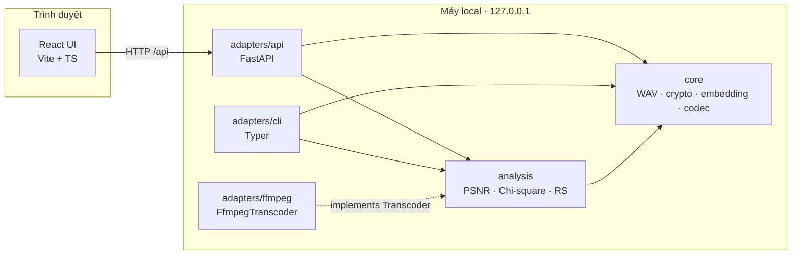

# Scope & Architecture

<aside>
🎯

**Mục tiêu CK:** biến lý thuyết GK thành sản phẩm chạy được: bộ công cụ encode/decode LSB cho file WAV, có chế độ hardened và bằng chứng thực nghiệm. Scope bám đúng Section 8 của Midterm Report, không mở rộng thêm.

**Kiến trúc đã chốt:** Python core (logic + phân tích) · FastAPI chạy local (adapter mỏng) · React + TypeScript (UI).

</aside>

## 1. Scope

### Tầng 1 — Lõi (bắt buộc, đúng đề bài)

- **WAV parser tự viết:** duyệt chunk theo RIFF, xử lý pad byte sau chunk có kích thước lẻ, chỉ chấp nhận PCM 16-bit mono/stereo (kể cả `WAVE_FORMAT_EXTENSIBLE` có subformat PCM). Định dạng khác → báo lỗi rõ ràng.
- **Encoder/decoder LSB replacement tuần tự** với length field 32-bit.
- **Capacity check:** message quá dài → từ chối, không ghi cắt cụt.
- **Ghi đè tại chỗ:** chỉ sửa byte trong `data` chunk → file stego giữ nguyên kích thước và header.

### Tầng 2 — Hardened mode (đã cam kết trong report)

- Passphrase → scrypt → HKDF tách thành 2 khóa độc lập: khóa AES-256-GCM và seed xáo thứ tự mẫu.
- **Keyed sample selection** (chống Chi-square).
- **LSB matching ±1** có ép hướng ở biên +32767 / −32768 (chống RS/SPA).

### Tầng 3 — Bằng chứng & chỉn chu

- Sau encode: hiện PSNR, MSE, % mẫu bị thay đổi.
- Waveform, difference signal, spectrogram (tương tác: zoom, hover).
- Chi-square sliding window: classic vs hardened ở nhiều embedding rate.
- Test MP3 round-trip: chứng minh message mất sau nén lossy.
- RS Analysis (nếu còn thời gian).
- Trang Listening Test (ABX) để kiểm chứng tiêu chí "không đoán đúng hơn mức ngẫu nhiên".

### Ngoài scope

- SPA, ML steganalysis, carrier FLAC/MP3, audio 8-bit / 24-bit, silence skipping.

**Lưu ý**

- Silence skipping bị loại vì tiêu chí chọn mẫu phải bất biến trước và sau khi nhúng. Với LSB matching, ±1 có thể làm mẫu vượt ngưỡng (vd 1 → 2) khiến decoder chọn khác encoder.

---

## 2. Quyết định kiến trúc

| Quyết định | Lý do |
| --- | --- |
| **Logic + phân tích viết bằng Python** | numpy vectorize phép bit trên hàng triệu mẫu; scipy có sẵn chi2, spectrogram; thư viện `cryptography` có AES-GCM, scrypt, HKDF. Demo và số liệu report chạy cùng một codebase. |
| **UI viết bằng React + TypeScript** | Trần UI cao hơn hẳn Streamlit: biểu đồ tương tác, audio player có waveform, trang ABX. |
| **FastAPI chỉ chạy local (127.0.0.1)** | Trình duyệt không chạy được Python nên cần một process trung gian. Chạy local thì passphrase không rời khỏi máy, giữ đúng threat model của report (stego-key không đi qua kênh công khai). Không hosting, không database, không state. |
| **Không dùng `scipy.io.wavfile` để ghi file** | Nó viết lại header và bỏ các chunk phụ (LIST…), vi phạm tiêu chí "giữ nguyên kích thước và header". |
| **Tự cài PRNG cho phép xáo, không dùng `numpy.random.Generator`** | numpy không cam kết output giống nhau giữa các phiên bản → khác máy là decode hỏng. |
| **Stego frame không có magic header / version byte** | Một chuỗi byte cố định là chữ ký dễ phát hiện. Chế độ (classic/hardened) do người dùng chọn khi decode. |

---

## 3. Tech stack

| Lớp | Công nghệ | Vai trò |
| --- | --- | --- |
| Core | Python 3.12, numpy, cryptography | Parse WAV, nhúng/trích xuất, KDF, AES-GCM |
| Analysis | scipy, matplotlib | Chi-square p-value, STFT, xuất hình tĩnh cho report |
| API | FastAPI, uvicorn, Pydantic v2, python-multipart | Adapter HTTP mỏng, tự sinh OpenAPI schema |
| CLI | Typer | Encode/decode hàng loạt, sweep embedding rate, test MP3 |
| Frontend | React, Vite, TypeScript, Tailwind CSS, shadcn/ui | Giao diện |
| Visualization | Plotly (react-plotly.js + bundle `plotly.js-cartesian-dist-min`), wavesurfer.js | Biểu đồ tương tác, audio player có waveform |
| Contract | openapi-typescript | Sinh type TS từ OpenAPI → đổi schema là frontend báo lỗi compile |
| Tooling | uv, pytest, hypothesis, ruff · npm, ESLint, Prettier | Quản lý dependency (có lockfile), test, lint |
| External | FFmpeg, Audacity / Sonic Visualiser | Test MP3; nghe và kiểm tra trực quan |

---

## 4. Kiến trúc tổng thể



**Quy tắc phụ thuộc (Clean Architecture nhẹ)**

- `core` không import gì từ `analysis` hay `adapters`, không đụng I/O: nhận và trả `bytes` / mảng numpy.
- `analysis` chỉ dùng `core`, không biết FastAPI hay FFmpeg tồn tại.
- `adapters` là nơi duy nhất chứa framework và I/O (HTTP, CLI, subprocess).

**Design pattern trong core**

- **Strategy:** `SampleSelector` (Sequential | KeyedShuffle) và `Embedder` (LsbReplacement | LsbMatching).
- **Factory method:** `StegoEncoder.classic()` / `StegoEncoder.hardened(passphrase)` lắp sẵn đúng bộ strategy.
- **Port / Adapter:** `analysis` định nghĩa protocol `Transcoder`; `FfmpegTranscoder` ở `adapters` hiện thực nó → test robustness được bằng fake transcoder.
- **Result dataclass:** encoder/analyzer trả dữ liệu (mảng, số đo), không trả hình. Cách hiển thị là việc của UI.
- Decoder chỉ cần `SampleSelector`, không cần `Embedder`: phép trích xuất `b = y & 1` giống hệt nhau cho cả replacement lẫn matching.

---

## 5. Project Structure

```
hidden-wave/
├── engine/                          # Python (uv project)
│   ├── pyproject.toml
│   ├── src/hiddenwave/
│   │   ├── __main__.py              # python -m hiddenwave → gọi lệnh serve của CLI
│   │   ├── core/
│   │   │   ├── wav/
│   │   │   │   ├── riff.py          # duyệt chunk, pad byte, validate fmt
│   │   │   │   └── wav_file.py      # WavFile: samples view (int16), ghi đè tại chỗ
│   │   │   ├── crypto/
│   │   │   │   ├── kdf.py           # scrypt + HKDF → aes_key, shuffle_seed
│   │   │   │   ├── cipher.py        # AES-256-GCM encrypt/decrypt
│   │   │   │   └── keystream.py     # PRNG tất định từ SHA-256 counter
│   │   │   ├── embedding/
│   │   │   │   ├── framing.py       # length prefix, pack/unpack bit (MSB-first)
│   │   │   │   ├── selectors.py     # SampleSelector: Sequential | KeyedShuffle
│   │   │   │   └── embedders.py     # Embedder: LsbReplacement | LsbMatching
│   │   │   ├── models.py            # StegoMode, value object, result dataclass
│   │   │   ├── codec.py             # StegoEncoder / StegoDecoder + factory
│   │   │   └── errors.py            # InvalidWavError, CapacityExceededError, MessageNotFoundError, AuthenticationFailedError
│   │   ├── analysis/
│   │   │   ├── metrics.py           # PSNR, MSE, change rate
│   │   │   ├── chi_square.py        # whole-file + sliding window
│   │   │   ├── sweep.py             # Chi-square cho hai chế độ theo nhiều embedding rate
│   │   │   ├── rs.py                # RS Analysis (tầng 3)
│   │   │   ├── signal_views.py      # downsample waveform, difference, spectrogram data
│   │   │   └── robustness.py        # protocol Transcoder + kiểm tra decode sau nén
│   │   └── adapters/
│   │       ├── api/
│   │       │   ├── app.py           # app factory, exception handlers, mount client build
│   │       │   ├── schemas.py       # Pydantic DTO
│   │       │   └── routers/         # encode.py, decode.py, analyze.py, system.py
│   │       ├── cli/
│   │       │   ├── main.py          # serve / encode / decode / evaluate
│   │       │   └── figures.py       # vẽ hình cho report bằng matplotlib
│   │       └── ffmpeg/
│   │           └── transcoder.py    # FfmpegTranscoder
│   └── tests/
│       ├── conftest.py              # sinh WAV fixture bằng code: mono, stereo, có LIST chunk, extensible, mẫu chạm biên
│       ├── unit/                    # core, analysis
│       ├── property/                # round-trip với hypothesis
│       └── api/                     # test endpoint bằng TestClient
├── client/                          # React + Vite + TS
│   ├── vite.config.ts               # proxy /api khi dev; build ra client/dist cho FastAPI phục vụ
│   └── src/
│       ├── api/                     # client + type sinh từ OpenAPI
│       ├── features/
│       │   ├── encode/
│       │   ├── decode/
│       │   ├── compare/             # nghe, số đo, biểu đồ cover vs stego
│       │   ├── analyze/             # Chi-square, so sánh theo embedding rate
│       │   ├── robustness/          # test MP3
│       │   └── listening-test/      # mở rộng (ABX)
│       ├── components/              # ui (shadcn), charts, AudioPlayer
│       └── App.tsx
├── evaluation/                      # output của lệnh evaluate: CSV + hình cho report
├── samples/                         # cover WAV (file lớn để ngoài git)
├── .gitignore
└── README.md                        # setup + chạy bằng một lệnh
```

---

## 6. Đặc tả dữ liệu nhúng (Stego frame)

**Quy ước chung**

- Thứ tự mẫu: theo mảng interleaved (L₁ R₁ L₂ R₂ …), không tách kênh.
- Thứ tự bit: MSB-first trong mỗi byte.
- N = tổng số mẫu (mọi kênh).

### Classic mode

| Vùng | Nội dung | Kích thước | Vị trí mẫu |
| --- | --- | --- | --- |
| Length | Độ dài message (byte) | 32 bit | Tuần tự từ mẫu 0 |
| Payload | Message thô (UTF-8) | 8 × L bit | Tuần tự tiếp theo |

Capacity tối đa: (N − 32) / 8 byte, làm tròn xuống.

### Hardened mode

| Vùng | Nội dung | Kích thước | Vị trí mẫu |
| --- | --- | --- | --- |
| Header | Salt (16B) + nonce (12B) | 224 bit | Tuần tự, mẫu 0–223 |
| Length | Độ dài ciphertext + tag (byte) | 32 bit | Theo thứ tự xáo trên mẫu 224 → N−1 |
| Payload | AES-GCM ciphertext + tag 16B | 8 × L bit | Tiếp theo trong thứ tự xáo |

Capacity tối đa (plaintext): (N − 224 − 32) / 8 − 16 byte.

**Dẫn xuất khóa**

- passphrase + salt → scrypt → master key 32B → HKDF-SHA256 tách thành `aes_key` (32B) và `shuffle_seed` (32B), mỗi khóa một `info` riêng.

**Thứ tự xáo**

- Partial Fisher–Yates trên dải chỉ số [224, N), chỉ chạy đúng số bước bằng số bit cần nhúng (dùng dict lưu các vị trí đã hoán đổi) → O(L) thay vì xáo cả triệu mẫu.
- Số ngẫu nhiên lấy từ keystream SHA-256(seed ‖ counter).
- Hướng ±1 của LSB matching dùng RNG hệ điều hành (không cần tái lập vì decoder không cần biết).

**Lưu ý**

- Salt/nonce phải nằm ở vị trí cố định vì cần salt *trước* mới derive được seed xáo. Salt và nonce không bí mật nên đặt công khai là an toàn; 224 mẫu quá ít để Chi-square bắt được.
- Decode với sai passphrase: thứ tự xáo sai → length đọc ra là rác → kiểm tra length so với capacity trước, rồi mới để GCM xác thực → trả `AuthenticationFailedError`.

---

## 7. API (local)

| Endpoint | Input | Output |
| --- | --- | --- |
| `GET /api/health` | — | Version, FFmpeg có sẵn hay không |
| `POST /api/capacity` | cover, mode | Số byte tối đa → UI hiện capacity khi đang gõ message |
| `POST /api/encode` | cover, message, mode, passphrase? | File stego (`audio/wav`) |
| `POST /api/decode` | stego, mode, passphrase? | Message |
| `POST /api/analyze/compare` | cover, stego | PSNR, MSE, change rate, waveform, difference, spectrogram data |
| `POST /api/analyze/chi-square` | file | p-value theo cửa sổ trượt |
| `POST /api/analyze/sweep` | cover, danh sách embedding rate | Chi-square classic vs hardened theo từng rate (tầng 3) |
| `POST /api/robustness/mp3` | stego, mode, passphrase? | Kết quả decode sau MP3 round-trip |

**Nguyên tắc**

- **Endpoint khai báo bằng `def` thường, không `async def`:** xử lý tín hiệu là CPU-bound, FastAPI sẽ tự chạy `def` trong threadpool thay vì chặn event loop.
- **Trả dữ liệu biểu đồ, không trả ảnh:** waveform giảm mẫu min/max theo bucket, spectrogram giảm về ma trận cỡ vài trăm × vài trăm trước khi gửi.
- **Ánh xạ lỗi tại adapter:** domain error trong `core` → HTTP status + error code trong exception handler (`InvalidWavError` → 400, `CapacityExceededError` / `MessageNotFoundError` / `AuthenticationFailedError` → 422).
- **Vệ sinh bảo mật:** chỉ bind `127.0.0.1`, không log message hay passphrase, giới hạn kích thước upload.
- **Chạy:** khi dev, Vite proxy `/api` sang uvicorn (không cần CORS). Khi demo, FastAPI phục vụ bản build của `client/` → một lệnh duy nhất.

---

## 8. Rủi ro đã rà soát

| Rủi ro | Cách xử lý |
| --- | --- |
| Hai toolchain (Python + Node) → mỗi máy cài một kiểu | Lockfile cho cả hai (uv, npm), README setup từng bước, script chạy một lệnh |
| Máy demo không có FFmpeg | `/api/health` báo trạng thái, UI tự ẩn tính năng test MP3 |
| Encoder và decoder lệch nhau (thứ tự mẫu, bit order) → ra rác mà không báo lỗi | Property test round-trip với hypothesis trên mọi fixture |

---

## 9. Lộ trình

**Phase 1 — Core classic**

- [ ]  WAV parser + fixtures (mono, stereo, LIST chunk, extensible)
- [ ]  Framing, Sequential selector, LsbReplacement, codec
- [ ]  Property test round-trip; CLI encode/decode

**Phase 2 — Hardened**

- [ ]  KDF, AES-GCM, keystream + partial Fisher–Yates
- [ ]  KeyedShuffle selector, LsbMatching (xử lý biên)
- [ ]  Test: sai passphrase, tái lập thứ tự xáo với seed cố định

**Phase 3 — Evaluation**

- [ ]  PSNR, change rate, Chi-square sliding window
- [ ]  Sweep embedding rate classic vs hardened trên nhiều file nhạc thật
- [ ]  FfmpegTranscoder + test MP3; RS Analysis nếu còn thời gian
- [ ]  Xuất bảng và hình cho report

**Phase 4 — API**

- [ ]  App factory, routers, schemas, exception handlers
- [ ]  Sinh OpenAPI → type TS

**Phase 5 — Web UI**

- [ ]  Trang Encode / Decode tối giản chạy end-to-end
- [ ]  Analyze: biểu đồ tương tác, so sánh audio
- [ ]  Listening Test (ABX), Robustness
- [ ]  Chau chuốt giao diện

**Lưu ý**

- Hết Phase 1 là đã có demo đạt yêu cầu tối thiểu của đề. Hết Phase 3 là đủ số liệu cho report. Phase 4–5 quyết định demo trông đẹp đến đâu, không quyết định demo có đạt hay không.